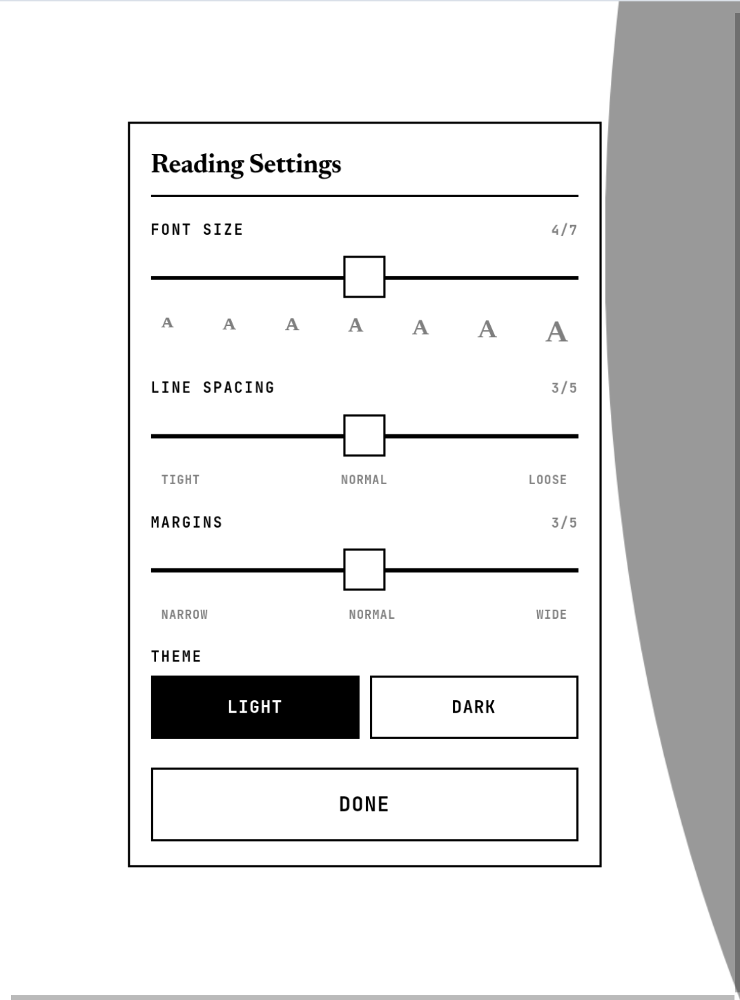

# kavita-epaper

A lightweight web UI for [Kavita](https://www.kavitareader.com/), tuned for e-ink readers and tablets. Reads EPUB only.

Kavita's built-in web reader works fine on desktops but is heavy on low-powered devices. Animated transitions, dark chrome surfaces, settings panels designed for mouse and keyboard. On e-ink readers like the OBOOK6 you get laggy navigation and bright UI elements that ghost across page turns. On tablets it works but is overkill if you just want to read.

kavita-epaper is a small FastAPI proxy that sits in front of your existing Kavita server. It uses Kavita's API for library, metadata, progress, and EPUB content. Only the front-end is replaced. Your Kavita install is still the source of truth, nothing is duplicated.

**EPUB only.** The built-in reader does not handle comics (CBZ, CBR, etc.) or PDFs. See [What this isn't](#what-this-isnt) below.

**A note on origins.** I'm not a programmer. Claude (Anthropic's AI) did the actual coding. I drove design decisions, on-device testing on a real OBOOK6, and the calls about what to ship. If you spot something questionable in the implementation, open an issue or PR. Honest criticism welcome.

## Quick start

1. **Have** a Debian 12 or Ubuntu 22.04+ machine (VM or LXC) with systemd and Python 3.10 or newer, which can reach your Kavita server. Root without `sudo` is fine: leave out `sudo` below.
2. **Install** the latest release:
   ```bash
   LATEST=$(curl -fsSL https://api.github.com/repos/coryjarboe/kavita-epaper/releases/latest \
     | grep -oE '"browser_download_url"[[:space:]]*:[[:space:]]*"[^"]*kavita-epaper-v[0-9][^"]*\.tar\.gz"' \
     | head -1 | grep -oE 'https://[^"]+')
   D=$(mktemp -d); curl -fsSL "$LATEST" | tar -xzf - -C "$D"
   sudo bash "$D/deploy/install.sh"; rm -rf "$D"
   ```
3. **Give it Kavita's address** when asked, as this machine reaches it (for example `http://192.0.2.20:5000`). It's checked before it's saved; press Enter if Kavita runs on the same machine. To skip the question, add `--kavita-url http://192.0.2.20:5000` to the `install.sh` command in step 2.
4. **Open** `http://<this machine's IP>:8095` in a browser. The installer prints the exact address.
5. **Sign in** with your Kavita username and password.

Then put it behind your reverse proxy for HTTPS ([Reverse proxy](#reverse-proxy), [Security](#security)) and add it to your home screen ([Add to home screen](#add-to-home-screen)).

## Tested on

Devices I've actually tested:

- **OBOOK6** (6" e-ink, ~375×500 CSS px portrait, Android-based). Primary target.
- **Samsung Galaxy Tab S10 FE.** Used as a PWA. Dark mode helps for night reading.
- **iPad (6th gen).** Used as a PWA via Safari.
- **Desktop browsers** (Chrome, Firefox, Safari). For admin and incidental reading. UI is tuned for small screens but doesn't break at desktop sizes.

If you try it on something else, open an issue with the device name and any quirks.

## Screenshots

| Library | Reader | Settings | Dark mode |
|---------|--------|----------|-----------|
|  |  |  |  |

## Features

- **Single sign-in.** Kavita username and password are sent once. The JWT, refresh token and API key are held in an encrypted HTTP-only cookie. Browser scripts never touch them.
- **Library-first UI.** No dashboard, no homescreen. Open the PWA and you're in your books. Snap-scroll library tabs, cover grid, big tap targets.
- **Built-in EPUB reader.** Proxies Kavita's `book-page` API and wraps it in an e-ink-friendly shell. CSS multi-column pagination via native `scrollLeft`. Same approach as Kavita's web reader so no edge bleed.
- **Progress syncs with Kavita.** Tap a book, resume where you left off. Tracked per-user via Kavita's `/api/Reader/get-progress` and `/api/Reader/progress` endpoints. Open the same book in Kavita's web UI on another device and your position is there too.
- **Dark mode.** Per-device toggle in reader settings (⚙). Light by default. Single CSS variable swap so the whole UI flips consistently.
- **EPUB downloads.** ↓ button on any chapter streams the EPUB through the proxy. Useful for sideloading to NeoReader, Calibre, KOReader, etc.
- **Grayscale covers.** Pre-rendered with Pillow before serving. Cuts file size and renders cleanly on e-ink.

## Requirements

- A reachable Kavita instance (1.0+, needs `book-page` and `get-progress` endpoints).
- Debian or Ubuntu LXC/VM with `systemd` and Python 3.10 or newer (`install.sh` adds `python3-venv` and `rsync` if missing). Tested on Debian 12 (Python 3.11). Debian 11 (Python 3.9) won't work.
- Not tested yet, reports welcome: unprivileged LXC containers without nesting (the service's systemd sandboxing may not start there), Ubuntu, Python 3.10 and 3.12 or newer.
- A reverse proxy with TLS (NPM, Caddy, Traefik, etc.) if you're exposing it past a trusted LAN.
- Optional: PWA-capable browser (Chrome, Edge, Safari) for install-to-homescreen.

> Upgrading from a previous release? See [`CHANGELOG.md`](./CHANGELOG.md) for version-specific notes, and [`MIGRATION.md`](./MIGRATION.md) for installs older than 0.7.15 or still named kavita-boox.

## Install

Pick whichever fits how you got the code.

### Option A: latest release from GitHub (recommended)

```bash
# Resolve the latest release tarball URL via the GitHub API, download, extract, install
LATEST=$(curl -fsSL https://api.github.com/repos/coryjarboe/kavita-epaper/releases/latest \
  | grep -oE '"browser_download_url"[[:space:]]*:[[:space:]]*"[^"]*kavita-epaper-v[0-9][^"]*\.tar\.gz"' \
  | head -1 | grep -oE 'https://[^"]+')
D=$(mktemp -d)
curl -fsSL "$LATEST" | tar -xzf - -C "$D"
cd "$D"
sudo bash ./deploy/install.sh
cd - >/dev/null && rm -rf "$D"
```

Pulls the latest tagged release. What most people want.

### Option B: clone the repo (gets latest `main`, may be ahead of releases)

Needs `git`.

```bash
git clone https://github.com/coryjarboe/kavita-epaper.git
cd kavita-epaper
sudo bash ./deploy/install.sh
```

Use this for the absolute latest, or if you plan to modify the code locally.

### Option C: from a tarball you already have

Run this from the directory that holds the tarball, or give the tarball's absolute path.

```bash
D=$(mktemp -d)
tar -xzf kavita-epaper-vX.Y.Z.tar.gz -C "$D"
cd "$D"
sudo bash ./deploy/install.sh
cd - >/dev/null && rm -rf "$D"
```

For offline installs, air-gapped environments, or pinning a specific version.

This creates:

- `/opt/kavita-epaper/` (code and venv)
- `/opt/kavita-epaper/.env` (config, auto-generated session secret, edit to point at your Kavita)
- `/var/cache/kavita-epaper/covers/` (grayscale cover cache)
- `/var/lib/kavita-epaper/releases/` (drop release tarballs here for no-args `update.sh`)
- `kavita-epaper` system user
- `kavita-epaper.service`

`install.sh` asks for Kavita's address when run in a terminal (default `http://127.0.0.1:5000`, Kavita on the same machine) and checks it before saving it. You can also pass it: `--kavita-url http://10.0.0.50:5000`, or `KAVITA_BASE_URL=... ` in the environment. When it isn't run in a terminal and Kavita doesn't answer, it warns, installs anyway, and says "Kavita: not reachable" at the end. It then starts the service, waits until the login page answers, and prints the addresses to open.

An existing `/opt/kavita-epaper/.env` is never overwritten. Rerunning `install.sh` keeps it (and refuses a new `--kavita-url`); to change the Kavita address, use the configure command (see [Changing settings](#changing-settings)):

```bash
sudo /opt/kavita-epaper/configure kavita-url http://10.0.0.50:5000
```

Or rerun with `--overwrite-env` to write a fresh `.env`: the old one is backed up to `/var/backups/kavita-epaper.env.<timestamp>` (the newest 5 are kept) and its secret is kept, so nobody is signed out.

Check it's running:

```bash
systemctl status kavita-epaper
journalctl -u kavita-epaper -f
```

## Add to home screen

kavita-epaper is a web app you can install like an app, so it opens full screen without the browser bar:

- **Android (Chrome, Edge):** open it, then menu ⋮ → *Add to Home screen* or *Install app*.
- **iPhone, iPad (Safari):** Share → *Add to Home Screen*.
- **E-readers:** depends on the browser. Many Android-based readers have Chrome or a browser with *Add to Home screen*; otherwise a bookmark works.

Installing as an app needs HTTPS on most browsers, so set up the reverse proxy first.

## Reverse proxy

Default bind is `0.0.0.0:8095` so the reverse proxy can live on a different host. Point a proxy host at `http://<kavita-epaper-host-ip>:8095`.

### NPM example

| Field                 | Value                              |
|-----------------------|------------------------------------|
| Domain                | `read.example.com` (or whatever)   |
| Scheme                | `http`                             |
| Forward host          | `<kavita-epaper host IP>`          |
| Forward port          | `8095`                             |
| Block common exploits | on                                 |
| Websockets            | off (not used)                     |
| SSL                   | whatever cert your proxy uses      |
| Force SSL             | on                                 |

Caddy and Traefik work the same way. Single HTTP upstream, no special headers needed past `X-Forwarded-Proto` (uvicorn runs with `--proxy-headers`). To accept those headers only from your proxy, see [Security](#security).

### If your reverse proxy is on the same host

Set `KAVITA_EPAPER_HOST=127.0.0.1` and `KAVITA_EPAPER_FORWARDED_ALLOW_IPS=127.0.0.1` in `/opt/kavita-epaper/.env` and restart. Limits exposure to localhost so the proxy is the only way in.

### Direct access without a reverse proxy

For a quick try, it works directly on its bound IP and port. Open `http://<host-ip>:8095` in a browser. The session cookie is issued without the `Secure` flag when accessed over plain HTTP (`KAVITA_EPAPER_COOKIE_SECURE=auto` does this by default), so login persists.

> **Security note.** kavita-epaper uses Kavita's own auth model. Your credentials are posted to Kavita on first sign-in over whatever transport you've configured. If you're comfortable accessing Kavita over plain HTTP on a trusted LAN, kavita-epaper sits at the same level. For anything internet-facing, put TLS in front of both, and see [Security](#security).

## Security

The defaults suit a trusted home LAN. For anything beyond that:

- **Trust only your proxy's forwarded headers** (`KAVITA_EPAPER_FORWARDED_ALLOW_IPS`).
  - The default `*` lets any client send `X-Forwarded-For` and `X-Forwarded-Proto`, so anyone who can reach the port can fake their logged IP and make plain HTTP look like HTTPS.
  - Set it in `.env` to your proxy's IP, e.g. `192.0.2.10`, or `127.0.0.1` for a proxy on the same host.
  - Several proxies: a comma-separated list, no spaces (`192.0.2.10,192.0.2.11`). CIDR ranges like `192.0.2.0/28` work too. IP addresses only, not hostnames.
  - Requests through a trusted proxy are logged with the real client IP (port `0`), and `KAVITA_EPAPER_COOKIE_SECURE=auto` sees the proxy's HTTPS. Anyone else is logged as they connect and their forwarded headers are ignored.
  - If the list misses your proxy, the logs show the proxy's IP and `auto` treats requests as plain HTTP, so the cookie loses its `Secure` flag.
  - Sign-in errors show the internal Kavita URL only to clients with private or loopback addresses. With `*`, a remote client can fake a private address and see it: another reason to set this.
- **Use HTTPS.** Put a TLS reverse proxy in front (see [Reverse proxy](#reverse-proxy)). Keep `KAVITA_EPAPER_COOKIE_SECURE` at `auto`, or `true` if you only ever use HTTPS (with `true`, sign-in won't stick over plain HTTP).
- **Don't expose the app port.**
  - Proxy on the same host: set `KAVITA_EPAPER_HOST=127.0.0.1`.
  - Proxy elsewhere: firewall port `8095` (`KAVITA_EPAPER_PORT`) to the proxy only, e.g. `sudo ufw allow from 192.0.2.10 to any port 8095 proto tcp` and no other rule for that port.
- **Check Kavita's certificate.** If Kavita itself uses HTTPS with a certificate from a private CA, point `KAVITA_CA_BUNDLE` at a PEM file with that CA: `sudo /opt/kavita-epaper/configure ca-bundle /etc/kavita-epaper/kavita-ca.pem` (see [Kavita over HTTPS](#kavita-over-https)). `KAVITA_TLS_VERIFY=false` turns the check off; not recommended, since anything between kavita-epaper and Kavita can then read the traffic, passwords included. It's logged as a warning at every start.
- **Use a long random secret.**
  - `install.sh` generates `KAVITA_EPAPER_SECRET`. To make one: `python3 -c 'import secrets; print(secrets.token_urlsafe(48))'`. The service refuses to start if it's missing, the `env.example` placeholder, or shorter than 32 characters.
  - It encrypts session cookies and keys the cover cache. Changing it signs everyone out, and covers are fetched again.
  - To rotate without signing everyone out: `sudo /opt/kavita-epaper/configure new-secret --keep-sessions`. The old secret is kept as `KAVITA_EPAPER_SECRET_PREVIOUS`, and old cookies are re-issued under the new secret the next time they open a page.
  - After `KAVITA_EPAPER_SESSION_TTL` (30 days by default): `sudo /opt/kavita-epaper/configure forget-previous-secret`. Anyone who hasn't opened a page since the rotation is signed out then.
  - `configure new-secret` without `--keep-sessions` signs everyone out at once.
- **Keep files root-owned.** `/opt/kavita-epaper/.env` stays `root:root` mode `600` (systemd reads it before switching to the service user), and `/opt/kavita-epaper` stays owned by root. `install.sh` and `update.sh` set both.
- **Update with `update.sh`.** It verifies the new unit, installs dependencies before stopping the service, resets ownership and the `.env` mode, and checks the service comes back up (see [Update](#update)).

## Update

Four ways:

```bash
# 1. Explicit tarball path
sudo /opt/kavita-epaper/update.sh /path/to/kavita-epaper-vX.Y.Z.tar.gz

# 2. URL (auto-downloads)
sudo /opt/kavita-epaper/update.sh https://my.server/kavita-epaper-vX.Y.Z.tar.gz

# 3. Auto-pick newest from a local release directory
sudo /opt/kavita-epaper/update.sh

# 4. Latest release from a GitHub repo
sudo /opt/kavita-epaper/update.sh --github coryjarboe/kavita-epaper
```

Mode 3 picks the highest-versioned `kavita-epaper-*.tar.gz` in `$KAVITA_EPAPER_RELEASES_DIR`. Defaults to `/var/lib/kavita-epaper/releases`. Adjust in `.env` if you drop tarballs somewhere else.

Mode 4 hits GitHub's `/releases/latest` API for the given `owner/repo`, finds the `kavita-epaper-v*.tar.gz` asset, and downloads it. Anonymous API access is rate-limited to 60 requests per hour per IP. For private repos or higher limits, export `GITHUB_TOKEN` and use `sudo -E`:

```bash
export GITHUB_TOKEN=ghp_...
sudo -E /opt/kavita-epaper/update.sh --github your-org/kavita-epaper
```

All four modes preserve `.env` and the cover cache, and are all or nothing:

- **Before anything stops:** the release's service unit is checked with `systemd-analyze verify`, the session secret is checked, and, if `requirements.txt` or `constraints.txt` changed, a new venv is built in `venvs/<id>` beside the running one (with the tested versions from `constraints.txt`). The running venv is never modified. Any failure here ends the update with the current version still running.
- **In the stop window:** the current version (code, `VERSION`, requirements, venv link, unit) moves to `previous/`, the new one moves in, and the `venv` symlink is switched.
- **Healthy** means the service is active and the login page answers within 20 seconds. Kavita being unreachable doesn't count against it; it's reported as a warning.
- **Not healthy:** everything is put back as it was before the update, including the unit, `update.sh` and `configure`, and the old version is started again. The new version's code is kept in `/opt/kavita-epaper/failed/` until the next update, for its log.
- **Interrupted** (power loss, killed): every step is journalled, and the next `update.sh` run undoes the half-done update first.

One previous version is kept, with its venv, so you can switch back without a tarball or network:

```bash
sudo /opt/kavita-epaper/update.sh --status            # current and previous versions, and what --rollback would do
sudo /opt/kavita-epaper/update.sh --rollback          # asks first, saying which way it switches
sudo /opt/kavita-epaper/update.sh --rollback --yes    # no question (needed when not in a terminal)
```

`--rollback` toggles: run it again and it switches forward. It's checked like an update (active and login page) and undone if the previous version doesn't come up. Installing an older release's tarball also works. Either way only the app goes back: `update.sh` and `configure` always stay the newest version you've installed. Unit backups in `/var/backups` are pruned to the newest 5.

The first update to 0.7.23 or newer also moves the existing `venv/` folder into `venvs/` and puts a symlink in its place; nothing needs reinstalling.

## Config

### Changing settings

`sudo /opt/kavita-epaper/configure` changes the common settings safely: it checks the new value, backs up `.env` to `/var/backups/kavita-epaper.env.<timestamp>` (the newest 5 are kept), writes it, restarts, and puts the old `.env` back if the service doesn't come up. Run it without arguments in a terminal for a menu, or:

```bash
sudo /opt/kavita-epaper/configure show                       # current settings (the secret only as "set, N characters")
sudo /opt/kavita-epaper/configure kavita-url http://10.0.0.50:5000   # checked first; --force saves an unreachable one
sudo /opt/kavita-epaper/configure trusted-proxies 192.0.2.10 # or a comma list, CIDR ranges, or any
sudo /opt/kavita-epaper/configure cookie-secure auto         # auto, true or false
sudo /opt/kavita-epaper/configure cover-ttl 86400            # seconds; 0 turns the disk cache off
sudo /opt/kavita-epaper/configure ca-bundle /etc/kavita-epaper/kavita-ca.pem   # or none
sudo /opt/kavita-epaper/configure kavita-tls-verify on       # off is not recommended
sudo /opt/kavita-epaper/configure new-secret --keep-sessions # rotate the session secret
sudo /opt/kavita-epaper/configure forget-previous-secret     # finish a rotation
```

Whether Kavita answers is shown after each change, but never undoes it. Everything else, edit `/opt/kavita-epaper/.env` directly and run `sudo systemctl restart kavita-epaper`.

### All settings

`/opt/kavita-epaper/.env`. The ones you'll actually touch:

| Variable                     | Default                         | Notes                                                |
|------------------------------|---------------------------------|------------------------------------------------------|
| `KAVITA_BASE_URL`            | `http://127.0.0.1:5000`         | Kavita API address (server-to-server). Change if Kavita isn't local. Include a sub-path if Kavita has one. |
| `KAVITA_CA_BUNDLE`           | unset                           | PEM file with a private CA for Kavita over HTTPS. See [Kavita over HTTPS](#kavita-over-https). |
| `KAVITA_TLS_VERIFY`          | `true`                          | `false` skips checking Kavita's certificate. Not recommended. |
| `KAVITA_EPAPER_HOST`         | `0.0.0.0`                       | Interface to bind. `127.0.0.1` is loopback only.     |
| `KAVITA_EPAPER_PORT`         | `8095`                          | TCP port to listen on.                               |
| `KAVITA_EPAPER_SECRET`       | auto-generated                  | Encrypts session cookies. At least 32 characters; the service won't start without one. Changing it signs everyone out; see below. |
| `KAVITA_EPAPER_SECRET_PREVIOUS` | unset                        | Old secret during a rotation; its cookies are still accepted. |
| `KAVITA_EPAPER_COOKIE_SECURE`| `auto`                          | `auto` follows request scheme. Or pin `true`/`false`.|
| `KAVITA_EPAPER_SESSION_TTL`  | `2592000` (30d)                 | Session lifetime in seconds.                         |
| `KAVITA_EPAPER_GRAYSCALE`    | `true`                          | Pre-render covers to grayscale. Disable for color.   |
| `KAVITA_EPAPER_COVER_TTL`    | `86400` (1 day)                 | Seconds a cached cover is served before refetching. `0` = no disk cache. Cached per user. Browsers keep a cover for at most an hour, and never past this. |
| `KAVITA_EPAPER_FORWARDED_ALLOW_IPS` | `*`                      | Who may set `X-Forwarded-*` headers. Your proxy's IP, e.g. `192.0.2.10`; see [Security](#security). |
| `KAVITA_EPAPER_KEEPALIVE_SECONDS` | `0` (off)                  | Reader pings `/ping` this often while visible, for e-readers whose Wi-Fi drops between page loads. Try `25`. |
| `KAVITA_EPAPER_RELEASES_DIR` | `/var/lib/kavita-epaper/releases` | Where `update.sh` looks when called with no args.  |

Restart after changes:

```bash
sudo systemctl restart kavita-epaper
```

To rotate `KAVITA_EPAPER_SECRET` without signing everyone out, see [Security](#security).

### Kavita under a sub-path

If Kavita is served under a path (Kavita's *Base URL* setting, for example `/kavita`), include it: `KAVITA_BASE_URL=http://10.0.0.50:5000/kavita`. kavita-epaper adds `/api/...` after it.

### Kavita over HTTPS

`KAVITA_BASE_URL=https://...` works as is when Kavita's certificate is from a public CA. For a private CA (or a self-signed certificate, which is its own CA):

```bash
sudo mkdir -p /etc/kavita-epaper
sudo cp kavita-ca.pem /etc/kavita-epaper/
sudo chmod 644 /etc/kavita-epaper/kavita-ca.pem
sudo /opt/kavita-epaper/configure ca-bundle /etc/kavita-epaper/kavita-ca.pem
```

The file needs to be readable by the `kavita-epaper` user and outside `/home` and `/root`, which the service can't see. If it's missing or not a PEM certificate, the service refuses to start and the log says why. The certificate is trusted in addition to the system CAs.

### Health check

`GET /healthz` answers `200 ok` when kavita-epaper is up and Kavita answers, and `503` with a short reason (for example `kavita: refused`) when it doesn't. It needs no sign-in, never shows the Kavita address, checks Kavita at most every 10 seconds, and isn't written to the access log. Use it for uptime monitors or your proxy's health checks.

### Service unit

`install.sh` and `update.sh` overwrite `/etc/systemd/system/kavita-epaper.service` whenever a release ships a changed one. `update.sh` checks the new unit with `systemd-analyze verify` first, saves the old one to `/var/backups/kavita-epaper.service.<timestamp>`, and puts it back if the service won't start. Edits made directly to the unit file are lost at that point, so put local changes in a drop-in, which updates never touch:

```bash
sudo systemctl edit kavita-epaper
```

This writes `/etc/systemd/system/kavita-epaper.service.d/override.conf`, for example:

```ini
[Service]
MemoryMax=256M
```

Settings the app reads (`KAVITA_*`) still belong in `.env`.

## Uninstall

```bash
sudo systemctl disable --now kavita-epaper
sudo rm -rf /opt/kavita-epaper /var/cache/kavita-epaper /var/lib/kavita-epaper /etc/systemd/system/kavita-epaper.service /etc/systemd/system/kavita-epaper.service.d
sudo userdel kavita-epaper
sudo systemctl daemon-reload
```

## What this isn't

- **Not a Kavita replacement.** A thin proxy and UI in front of Kavita. Kavita does the actual work (library scan, metadata, progress storage, EPUB parsing).
- **EPUB only.** The built-in reader handles EPUB. No support for comics (CBZ, CBR, CB7, CBT, ZIP, RAR, 7Z), PDF, or raw image folders. Library browse still works for those formats and the download button still streams the file, but the reader button is hidden for non-EPUB items. Read those in Kavita's own web reader, or download and open them in a dedicated app.
- **Not multi-user-aware in any special way.** Each browser session authenticates against Kavita and gets its own cookie. No user management here, it's all Kavita's user system.
- **No background sync, no offline reading.** Online only. The service worker is intentionally a network pass-through (no caching) so library changes show up immediately.

## File layout

```
/opt/kavita-epaper/
├── app/                  # FastAPI app
│   ├── main.py
│   ├── kavita_check.py   # reaching Kavita (used by the app and install.sh)
│   ├── static/           # CSS, JS, icons, manifest
│   └── templates/        # Jinja2 (base, library, series, read, login)
├── venv -> venvs/<id>    # symlink to the current virtualenv
├── venvs/                # one venv per set of dependencies (current and previous)
├── previous/             # the kept previous version, for update.sh --rollback
├── failed/               # code of a failed update, until the next one (only after a failure)
├── requirements.txt
├── constraints.txt       # tested versions of every package pulled in
├── VERSION
├── .env                  # config (root:root, chmod 600)
├── update.sh             # updates, --status, --rollback
└── configure             # changes settings safely
```

Listens on `0.0.0.0:8095` by default. Set `KAVITA_EPAPER_HOST=127.0.0.1` in `.env` for loopback-only when the reverse proxy is on the same host. Always front it with a TLS-terminating reverse proxy in production.

## License

MIT. See [`LICENSE`](./LICENSE).
